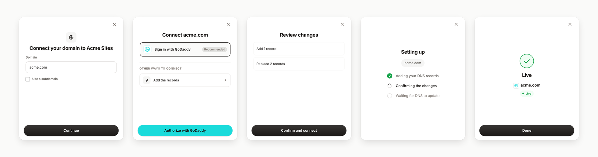

<picture><source media="(prefers-color-scheme: dark)" srcset=".github/media/customdomain-mark-dark.png"></picture>

<h1 align="center">CustomDomain Homebrew tap</h1>

<b>Install the CustomDomain™ CLI with Homebrew, then give your project its API key and add the widget.</b>

   

<picture><source media="(prefers-color-scheme: dark)" srcset=".github/media/widget-flow-dark.png"></picture>

## Install

| <picture><source media="(prefers-color-scheme: dark)" srcset="https://cdn.simpleicons.org/homebrew/e7e5e4"></picture> | `brew install custom-domain-app/tap/customdomain` |
|---|---|

The formula installs the [CustomDomain™ CLI](https://github.com/CUSTOM-DOMAIN-APP/customdomain-cli). Start with
`customdomain init` in your project.
